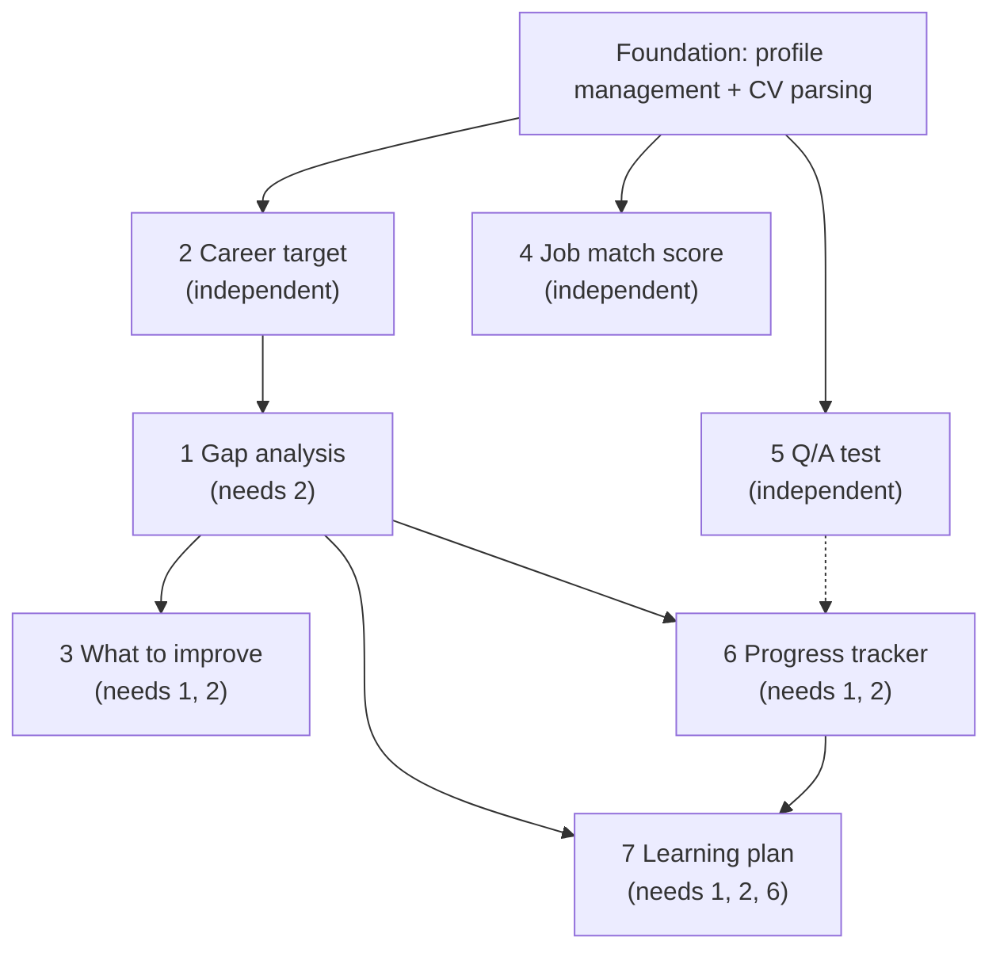

# Development Plan

## Planning order

1. List every workflow.
2. Mark each as **independent** (no inputs from other workflows) or **dependent**.
3. Plan and build the independent ones first.
4. Profile management is the obvious first candidate, since other workflows read user data from it.

For each dependent workflow, record its prerequisites explicitly: which workflows must exist, and which data or API endpoints it needs from them. Order the build by dependency, so nothing is built before what it relies on.

## Layers

| Layer | Role |
|---|---|
| **n8n** | Workflow logic and orchestration |
| **FastAPI** | API layer, with endpoints that n8n and the frontend call |
| **Frontend** | Generated with AI, one page per workflow |

## Page template for each workflow

- **Name and purpose**
- **Type:** independent or dependent
- **Prerequisites** (workflows, data, endpoints), for dependent workflows only
- **Trigger and inputs**
- **Steps** (the n8n node flow)
- **FastAPI endpoints** (method, path, request and response shape)
- **Data read and written**
- **Outputs** and the next workflows it feeds
- **Frontend page:** the screens and actions it needs
- **Error and edge cases**

## Foundation: profile management and user experience data

Treat this as the first workflow. It stores each user's experience level and related attributes. Other workflows read it to adapt what the user sees or what data is available to them.

**Open question:** what does "experience" mean in this system? Options include levels (beginner, intermediate, expert), years, or role-based tiers.

## Build order

| Build # | Journey step | Workflow | Type | Prerequisites |
|---|---|---|---|---|
| 1 | 2 | Knowing the future career | Independent | Profile, CV parsing |
| 2 | 4 | Evaluate CV against job offers (score) | Independent | Profile, CV parsing |
| 3 | 5 | Testing in Q/A form | Independent | Profile, CV parsing |
| 4 | 1 | CV gaps analysis | Dependent | Step 2 (target career profile) |
| 5 | 3 | What to add or improve | Dependent | Step 2, Step 1 |
| 6 | 6 | Tracking progress to goal | Dependent | Step 2 (goal), Step 1 (baseline) |
| 7 | 7 | Learning recommendations | Dependent | Step 1, Step 2, Step 6 |

Steps 3, 6 and 7 also read step 2's target career profile. Those arrows are left out of the graph to keep it readable.

## Dependency graph

The dashed arrow is an optional link: step 5's Q/A results can adjust skill levels in step 6, but step 6 does not need them to run.

Mermaid version, for pasting into docs that render it:

## Shared data to define once

| Data | Produced by | Read by |
|---|---|---|
| Target career profile | Step 2 | Steps 1, 3, 6, 7 |
| Gap report | Step 1 | Steps 3, 6, 7 |
| Progress state | Step 6 | Step 7 |

## Soft links (optional, not blocking)

- Step 4's job postings can feed step 2 as the "job requirements example".
- Step 5's Q/A results can adjust the skill levels in step 6.

## Open question for step 6

How do users report "updates on their skills": manual input, a new CV upload, or both? This decides step 6's inputs and its FastAPI endpoints.
